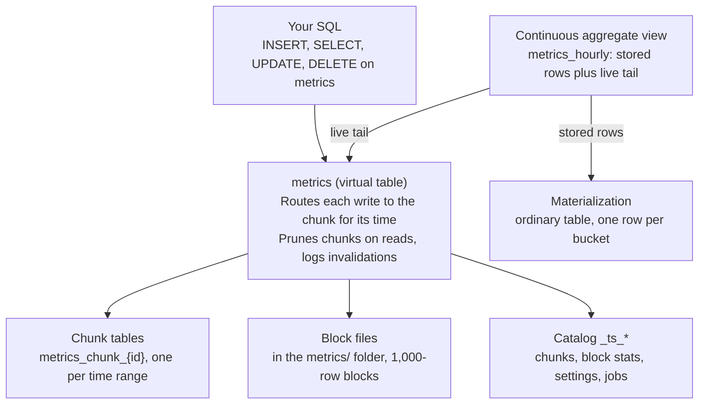

# Hypertables

[← Contents](README.md)

A hypertable is a virtual table that keeps the original table's name and columns and stores rows in ordinary chunk tables, one per time range. Queries and writes against the virtual table must behave exactly like the same SQL on a plain table, except for the documented [SQLite limits](01-sqlite-constraints.md).

**One table to the user: hot rows in SQLite, sealed blocks in files.** `metrics.db` holds hot rows, the catalog and statistics; `metrics/` holds block files.

Hot rows, the catalog and every statistic are ordinary SQLite tables, so uncompressed data stays readable without the extension; only sealed block data lives in files.

## Registration and catalog

| ID | Requirement | Priority |
| --- | --- | --- |
| HT-01 | `create_hypertable(table, time_col, chunk_interval [, options])` converts an existing ordinary table. Its column definitions become the template for every chunk, and the user-visible name becomes the virtual table. | Must |
| HT-02 | Existing rows move into chunks in the same transaction. Converting a non-empty table requires an explicit `migrate_data` option. | Must |
| HT-03 | The chunk catalog records, per chunk: id, hypertable, range start (inclusive), range end (exclusive), space partition, status, table name, row-count estimate, and created and compressed timestamps. | Must |
| HT-04 | Chunk ranges are aligned to `chunk_interval` from a fixed origin, so every connection computes the same boundaries and ranges never overlap. | Must |
| HT-05 | Every chunk table carries a `CHECK` constraint on its time range, so direct writes to a chunk cannot break routing. | Must |
| HT-06 | `drop_hypertable` and `DROP TABLE` on the virtual table remove all chunks and catalog rows. `ALTER TABLE ... RENAME` renames chunks and catalog entries. | Must |
| HT-27 | `create_hypertable` refuses a table that has triggers, because virtual tables cannot have them. The error names the triggers. | Must |
| HT-28 | `create_hypertable` refuses a table that other tables reference with foreign keys, because a foreign key cannot point to a virtual table. | Must |
| HT-29 | Indexes already on the original table become hypertable indexes, as if created with `create_hypertable_index`, so every chunk gets them. | Should |
| HT-30 | `WITHOUT ROWID` tables, views and virtual tables are refused with a clear error in v1. | Must |

### What `create_hypertable` does

The call runs as one transaction, so it either completes or changes nothing.

1. Validates the table and arguments (HT-01, HT-02, HT-14, HT-27 to HT-30), including that the chunk interval is fixed width.
2. Creates the `_ts_` catalog on first use, or checks its version (NF-13).
3. Records the hypertable: time column, unit, chunk interval, origin, options, and the column template every chunk copies (HT-01, HT-15).
4. Renames the original table to an internal name, freeing its name.
5. Creates the virtual table under the original name, with the same columns.
6. With `migrate_data`, creates one chunk per time range present (CHECK constraint, default index, catalog row) and copies that range's rows in (HT-03 to HT-05, HT-22).
7. Retires the internal original with a two-phase drop (LC-02), because a drop inside a running statement can fail (risk 2 in [Risks](15-risks.md)).
8. Bumps the catalog generation counter (NF-03), commits and returns the hypertable id.

Later chunks are created on first insert (HT-08).

## Writes

| ID | Requirement | Priority |
| --- | --- | --- |
| HT-07 | Inserts through the virtual table go to the chunk covering the row's time, using a cached prepared statement per chunk. | Must |
| HT-08 | A missing chunk is created inside the inserting transaction, so a rollback removes both the table and its catalog row. Concurrent creators resolve through a unique catalog key on (hypertable, range start, space partition). | Must |
| HT-09 | A NULL or unconvertible time value is rejected with `SQLITE_CONSTRAINT`, never routed to a default chunk. | Must |
| HT-10 | UPDATE changes rows in place. If the new time crosses a chunk boundary, the row moves with a delete plus insert in one step. | Must |
| HT-11 | DELETE with a time range only visits the matching chunks. | Must |
| HT-12 | The virtual table's rowid encodes chunk id plus local rowid in 64 bits. It is stable while the row stays in an uncompressed chunk; the docs state that compression changes rowids. | Must |
| HT-13 | `INSERT OR IGNORE`, `OR REPLACE`, `OR ABORT`, `OR FAIL` and `OR ROLLBACK` work through conflict-mode support in the virtual table. `ON CONFLICT DO UPDATE` is documented as unsupported. | Must |
| HT-14 | Unique constraints and primary keys are allowed only if they include the time column (and the space key, when one exists), because uniqueness is enforced per chunk. This is TimescaleDB's rule too. | Must |
| HT-15 | NOT NULL, CHECK and DEFAULT from the template are enforced on writes through the virtual table, whether or not SQLite enforces them for virtual tables. | Must |

## Reads and pruning

| ID | Requirement | Priority |
| --- | --- | --- |
| HT-16 | `xBestIndex` consumes `=`, `<`, `<=`, `>`, `>=`, `IN` and `IS NULL` constraints on the time column, and `xFilter` scans only chunks that overlap them. | Must |
| HT-17 | If a constraint value cannot be converted to the time unit, the scan includes all chunks. Pruning must never drop a qualifying row. | Must |
| HT-18 | Other usable constraints (equality, range, `IN` on any column) are forwarded into the per-chunk SQL so chunk indexes apply. A constraint is marked `omit` only when the chunk query fully enforces it. | Must |
| HT-19 | Cost and row estimates come from catalog row counts, so the planner can order joins sensibly. | Must |
| HT-20 | `ORDER BY time ASC/DESC` is satisfied by scanning chunks in order, so `ORDER BY ts DESC LIMIT 1` reads one chunk. `LIMIT` and `OFFSET` are pushed down when there are no other unconsumed constraints. | Should |
| HT-21 | Only columns the query uses (`colUsed`) are fetched from chunks. | Should |

## Indexes, schema changes and partitioning

| ID | Requirement | Priority |
| --- | --- | --- |
| HT-22 | Every chunk gets an index on the time column by default, or on (space key, time) when space partitioning is on. | Must |
| HT-23 | `create_hypertable_index(table, name, columns [, unique])` and `drop_hypertable_index` apply to all existing chunks and are recorded so future chunks get them. | Must |
| HT-24 | `hypertable_add_column`, `hypertable_rename_column` and `hypertable_drop_column` change the template, every chunk and every compressed chunk, then refresh the virtual table's declared schema. | Should |
| HT-25 | `add_dimension(table, column, partitions)` adds hash space partitioning. Equality or `IN` on the key prunes partitions. | Could |
| HT-26 | A generated read-only view over all chunks lets tools without the extension read uncompressed data, within the 500-term compound limit. | Should |
