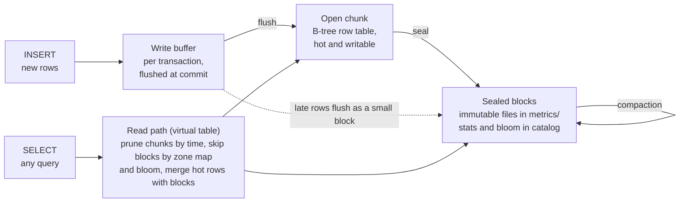

# Storage engine techniques

[← Contents](README.md)

All seven techniques fit, but only as a layer built from ordinary SQLite tables and blobs. An extension cannot change SQLite's page format, so "append-only" and "SSTables" apply to rows and blocks, never to the database file itself.

| Technique | Fits SQLite? | How it maps | What SQLite rules out |
| --- | --- | --- | --- |
| Append-only storage | Yes, logically | An `append_only` hypertable rejects UPDATE and DELETE. Chunks seal once their time range closes and never change after that. | A physically append-only file. SQLite rewrites B-tree pages in place; WAL mode, which appends pages until a checkpoint, is the closest built-in behaviour. |
| MemTable | Yes, per transaction | Rows are buffered in memory and flushed sorted at commit, which is what FTS3 does with its pending-terms hash in `xSync` ([fts3.c](https://www.sqlite.org/src/info/af55ca5fc6778cb6)). | A buffer that outlives a commit: committed rows would be lost on a crash and invisible to other connections. |
| SSTables and compaction | Yes, as files beside the database | Sealed data becomes sorted, immutable blocks in files beside the database, with their statistics in the catalog (see [Block files](08-block-files.md)). Compaction merges small blocks, as FTS5 incrementally merges its segment b-trees ([fts5 check-in](https://sqlite.org/src/info/556671444c03e3af)). | SQLite's bundled `lsm1` engine as a backend: it commits its separate file on its own, so it and SQLite can disagree after a crash, and it stores floats in native byte order ([lsm_vtab.c](https://www.sqlite.org/src/artifact/529255dc70428900)). |
| Delta encoding and compression | Yes, per block | The LC-08 codecs run inside each block. | Compressing whole pages, which needs a custom VFS (out of scope). Open row chunks keep SQLite's own variable-length integer format. |
| Time-based partitioning | Yes, the core design | Chunks per time range (see [Hypertables](04-hypertables.md)), plus sealing, merging of small old chunks and optional archive files. | Atomic moves between files in WAL mode, where transactions are atomic per file only ([ATTACH](https://sqlite.org/lang_attach.html)); attached files are capped at 10 by default and 125 at most ([limits](https://sqlite.org/limits.html)). |
| Block metadata and planning | Yes | Zone maps per block (min, max, NULL count, rows) and per-chunk ranges for chosen columns, like TimescaleDB's [chunk skipping](https://docs.timescale.com/api/latest/hypertable/enable_chunk_skipping). | Answering `count`, `min` or `max` from metadata inside an ordinary query, because SQLite never pushes aggregates into a virtual table. |
| Bloom filters | Yes, on sealed blocks | One filter per block for chosen columns, checked for `=` and `IN`, as TimescaleDB's bloom sparse indexes do ([CREATE TABLE](https://www.tigerdata.com/docs/reference/timescaledb/hypertables/create_table)). | Skipping when SQLite's comparison rules make a match uncertain: non-BINARY collations, or values that type affinity would convert. |
| Downsampling | Yes | Tiers of continuous aggregates, each with its own retention, created by one policy. | Tiers built from other tiers until CA-12 exists; in v1 every tier reads raw data. |

**Writes land as sorted blocks; reads skip what metadata rules out.** Hot rows and statistics stay in the SQLite file; sealed blocks are files beside it.

Hot rows and every statistic stay in the SQLite file. Sealed blocks move to the block directory described in [Block files](08-block-files.md), so the extension, not SQLite, guarantees their durability and backups.

## Requirements

| ID | Requirement | Priority |
| --- | --- | --- |
| SE-01 | `create_hypertable(..., append_only => true)` makes UPDATE and DELETE through the virtual table fail with `SQLITE_CONSTRAINT`. `drop_chunks` still works. | Must |
| SE-02 | Chunks move through open, sealed, compressed and dropped states. A chunk seals once `seal_after` (proposed: one chunk interval) has passed since its range ended; sealed chunks change only through compaction. | Must |
| SE-03 | Late rows for a sealed range follow a per-hypertable policy: reject them, or write them as a small block that compaction merges later (this replaces the LC-13 side table once blocks exist). | Must |
| SE-04 | Open chunks can defer secondary indexes until sealing, so hot writes maintain only the time index. | Should |
| SE-05 | A transaction-scoped write buffer holds rows inserted through the virtual table, per chunk, and flushes them in time order at `xSync` and before each savepoint, or earlier past a size limit (proposed 8 MiB). | Should |
| SE-06 | Reads in the same transaction see buffered rows; a rollback, full or to a savepoint, discards them. No buffered row survives a commit. | Must |
| SE-07 | Sealed data is stored as sorted, immutable blocks of up to `batch_size` rows: per-column min, max and NULL count, the row count and optional bloom filters go to the catalog, and the encoded columns go to a block file. | Must |
| SE-08 | Bulk inserts of at least `batch_size` rows into a sealed range are written directly as blocks, skipping the row chunk. | Should |
| SE-09 | `add_compaction_policy(table)` merges a chunk's small blocks (under half of `batch_size`) into full sorted blocks once more than N exist (proposed 4, FTS5's automerge default). Each run is atomic per chunk, bounded by a work budget and resumable. | Should |
| SE-10 | DELETE on sealed rows writes tombstones that reads apply and compaction purges. Until then, LC-14's clear error applies. | Could |
| SE-11 | Each block picks its codec per column by trying the candidates and keeping the smallest; the header records the choice. | Must |
| SE-12 | Row chunks can store time as an offset from the chunk start, so SQLite writes smaller integers. Off by default, because raw chunk tables then need the extension to be read. | Could |
| SE-13 | `merge_chunks(table, older_than, target_interval)` merges adjacent sealed chunks to reduce chunk count (see NF-07 in [Non-functional requirements](10-non-functional.md)). | Should |
| SE-14 | An archive tier moves block files to a second directory or disk by copy, verify, then catalog update. | Could |
| SE-15 | Every block has zone maps for every orderable column, and scans skip blocks that cannot satisfy range or equality constraints. | Must |
| SE-16 | `enable_chunk_skipping(table, column)` records each chunk's min and max for that column at sealing and prunes chunks with them. | Should |
| SE-17 | `xBestIndex` estimates rows from catalog statistics and, where SQLite supplies it, the constraint value (`sqlite3_vtab_rhs_value`). Estimates never change results. | Must |
| SE-18 | `ts_block_stats(table, start, end)` returns per-block row counts, min and max, so dashboards can read totals without decoding. | Should |
| SE-19 | `set_bloom_filter(table, columns [, bits_per_key])` builds one filter per block at sealing or compaction, default 10 bits per key (about 1% false positives). Filters are never updated in place. | Should |
| SE-20 | A bloom filter is consulted only for `=` and `IN` on BINARY-collated columns, after applying the column's affinity to the constraint value; otherwise the block is scanned. Property tests check for zero false negatives. | Must |
| SE-21 | `add_downsampling_policy(table, raw_retention, tiers)` creates a continuous aggregate, refresh policy and retention policy per tier, for example 1-minute buckets kept 90 days and 1-hour buckets kept forever. | Should |
| SE-22 | Raw retention never drops a chunk that a downsampling tier has not materialized yet; the drop waits until every tier's watermark has passed it. | Must |
| SE-23 | `lttb(ts, value, n)` returns n points for chart downsampling, matching TimescaleDB Toolkit's `lttb`. | Could |

SE-01 to SE-04 and SE-13 join Phase 2, SE-21 and SE-22 join Phase 4, and the block layer (SE-05 to SE-12, SE-15 to SE-20) joins Phase 5 (see [Phasing](13-phasing.md)). Two spikes for this layer appear under [Risks](15-risks.md) (8 and 9).
