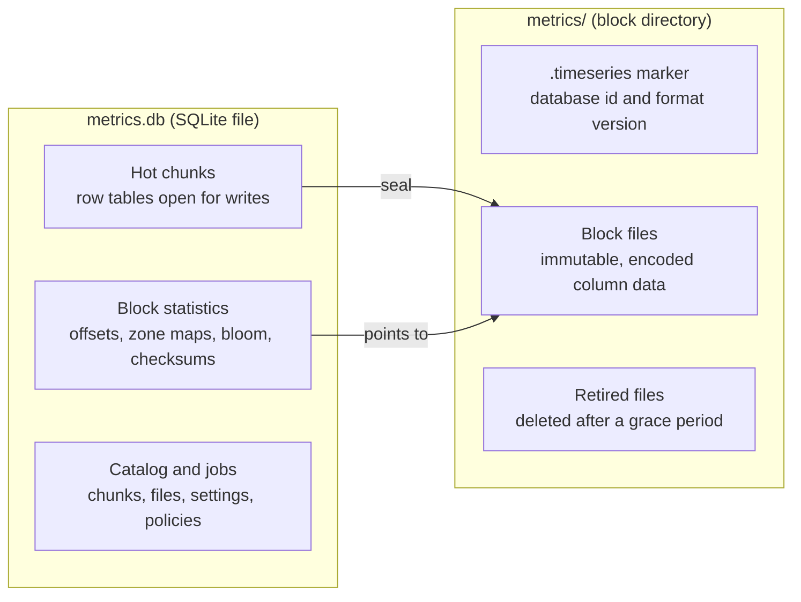

# Block files

[← Contents](README.md)

Sealed blocks are stored as immutable files in a directory beside the database and named after it, while hot rows, the catalog and every block statistic stay in the SQLite file. This frees compression and file layout from SQLite's page format, and dropping old data frees disk space at once. In exchange, the extension, not SQLite, must make those files durable, consistent and part of backups.

**Statistics stay in SQLite; block data lives in files beside it.** Layout for a database named `metrics.db`:



On disk:

```text
app/
├── metrics.db            hot chunks, catalog, block statistics, jobs
└── metrics/              block directory
    ├── .timeseries       marker: database id and format version
    └── *.blk             immutable block files (names generated by the extension)
```

The catalog is the source of truth: a block file exists for queries only once a committed catalog row points to it.

## Write protocol

1. Encode the blocks in memory and write them to a temporary file inside the directory.
2. Flush the file to disk, rename it to its final name, then flush the directory.
3. In the SQLite transaction, insert the catalog rows: file name, size and checksum, plus each block's column offsets, row count, zone maps and bloom filters.
4. Commit. Readers see the new blocks only from this point.
5. Retire what the file replaces (a row chunk or older files): hidden at commit, deleted after a grace period.

A crash before step 4 leaves an unreferenced file that cleanup removes; a crash after it leaves a complete, flushed file.

## Requirements

| ID | Requirement | Priority |
| --- | --- | --- |
| BF-01 | The block directory sits next to the database and takes its file name minus the extension (`metrics.db` → `metrics/`). The path comes from `sqlite3_db_filename`, never from SQL arguments. | Must |
| BF-02 | A marker file (`.timeseries`) records the database id and format version. A directory with no marker, or one naming another database, is refused with a clear error, which guards against name clashes and copied files. | Must |
| BF-03 | Block files are immutable: written once and never changed. Compaction and recompression write new files. | Must |
| BF-04 | Every new file follows the write protocol above, and is visible to queries only through a committed catalog row. | Must |
| BF-05 | The catalog holds every statistic per block: file, byte offset and length per column, row count, per-column min, max and NULL count, bloom filters and a checksum. Pruning never opens a file. | Must |
| BF-06 | Scans read only the byte ranges of the columns a query uses, only for blocks that survive pruning, and verify checksums. A mismatch raises `SQLITE_CORRUPT` naming the file. | Must |
| BF-07 | A missing directory or referenced file makes the affected query fail with an error naming the path. It never returns partial results. | Must |
| BF-08 | Retired files are recorded with a retire time and deleted by `run_jobs()` after a grace period (proposed 1 hour), so readers on older snapshots in other processes finish first. | Must |
| BF-09 | Files that no committed catalog row references, and that are older than the grace period, are deleted by `run_jobs()` or `ts_cleanup()`. `ts_check()` reports missing, extra and corrupt files. | Must |
| BF-10 | When two processes seal or compact the same chunk, only the one whose catalog commit succeeds keeps its file; the other file becomes an orphan for BF-09. | Must |
| BF-11 | `drop_chunks` on file-backed chunks frees disk space as soon as the files are deleted, with no `VACUUM`. | Must |
| BF-12 | Databases with no usable directory (in-memory, temporary, read-only media, browser builds) keep sealed blocks as blobs in a catalog table, in the same block format. A read-only directory allows reads but not sealing or compaction. | Must |
| BF-13 | The extension generates every file name (chunk id, run id, random suffix, `.blk`). Paths never leave the directory, and symbolic links inside it are refused. | Must |
| BF-14 | `ts_backup(dest)` copies the database with `VACUUM INTO` plus the files its catalog references, from one read snapshot, and pauses file deletion until the copy ends. The docs warn that copying only the `.db` file loses sealed data. | Must |
| BF-15 | Files are written per run, and compaction works toward one file per sealed chunk, keeping file count close to chunk count. | Should |
| BF-16 | Each file ends with a footer repeating its block index, so `ts_rebuild_stats()` can restore catalog statistics from the files. | Should |
| BF-17 | Connections cache open file handles up to a limit (proposed 64) and can read through memory maps. | Should |
| BF-18 | Crash tests kill the process at every protocol and deletion step; after reopening, query results match and `ts_check()` is clean. | Must |

Block files land in Phase 5 with the block layer (see [Phasing](13-phasing.md)). Until then, and wherever BF-12 applies, sealed data uses the in-database layout.
