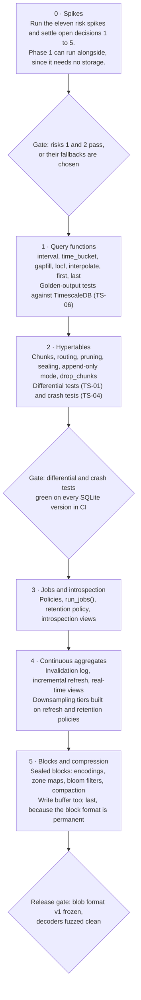

# Phasing

[← Contents](README.md)

Build in six phases, starting with throwaway spikes, because two of the [risks](15-risks.md) decide whether the virtual-table design works at all.

**Spikes settle the design before any storage code is written.** Each phase closes with its own tests.

Continuous aggregates come before compression: they deliver the bigger query win, and compression's blob format cannot change once a release ships it.
